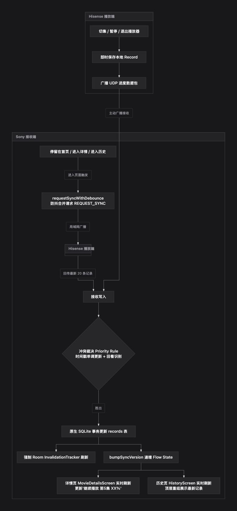

# 独播库TV 局域网跨设备进度同步设计与实现原理 (LAN Playback Sync Architecture)

## 1. 概述与设计背景 (Overview)

在家庭多 TV 设备环境（如客卧的小米盒子 Android 5.1 与客厅的 Sony Bravia Android 10/FireTV）下，独播库TV 原生仅依赖各自本地数据库（Room SQLite），无法跨设备共享播放历史与播放断点。

为了在**不依赖外部云端自建服务器**的前提下实现静默、实时的跨屏接续播放，本方案基于 **UDP 局域网无中心对等广播协议 (Decentralized UDP Peer-to-Peer)**，并在 Smali 字节码层深度集成到 Android 播放器生命周期、Room 数据库响应式链路以及 Jetpack Compose 渲染树中。

---

## 2. 核心系统架构 (System Architecture)

```mermaid
flowchart TD
    subgraph Device_A [发送端 TV (如 Sony TV)]
        A1[ExoPlayer / 播放器退出或切集] --> A2[LanSyncManager.sendPlaybackSync]
        A2 -->|组装 JSON 记录| A3[UDP Socket 端口 9876 广播]
    end

    subgraph LAN [家庭局域网 UDP Broadcast (255.255.255.255:9876)]
        A3 --> B1[局域网数据包]
    end

    subgraph Device_B [接收端 TV (如 小米盒子)]
        B1 --> C1[LanSyncManager UDP 接收监听线程]
        C1 --> C2{过滤自身广播 & 解析 JSON}
        C2 --> C3{冲突裁决 Priority Rule}
        C3 -->|胜出| C4[原生 SQLite 事务更新 records 表]
        C4 --> C5[Room InvalidationTracker 强制刷新]
        C4 --> C6[bumpSyncVersion 递增 Flow State]
        C6 --> C7[MovieDetailsScreen Compose 重组]
        C7 --> C8[resolveLatestRecord 读取最新进度]
        C8 --> C9[formatButtonText 更新为 '继续播放 第X集 XX%']
    end
```

---

## 3. 关键机制与实现原理 (Key Principles)

### 3.1 UDP 对等通信协议
- **监听端口**：固定为 `9876`。
- **协议格式**：UTF-8 编码的 JSON 数据包。
  - **同步数据包**：包含 `from` (设备唯一ID)、`id`、`name` (剧名)、`episode` (集数，如 "第5集")、`progressInMillis`、`durationInMillis`、`modifiedAt`、`detailPageUrl` 等。
  - **对等请求包**：`{"action": "REQUEST_SYNC", "from": "..."}`。在 App 启动 (`onAppCreate`) 或切到前台 (`onActivityResume`) 时全网广播，对端收到后会响应回传本地最新 20 条观看记录 (`respondAllRecords`)。
  - **防死循环机制**：每台设备在内存中依据 `Build.MODEL + android_id` 生成唯一 `sCurrentDeviceId`。接收时若 `from` 与本机 ID 相同则直接丢弃，避免广播风暴。

### 3.2 播放进度覆盖与冲突裁决算法 (Priority Rules)
当接收端本地已有相同剧集的记录时，并非盲目覆盖，而是严格遵循以**操作时间戳为主导 (Monotonic Timestamp First)** 的裁决逻辑，既防御网络乱序包，又保证用户主动切集与回看操作的无缝同步：
1. **时间戳优先（Monotonic Timestamp Guard）**：
   - 比较远端更新时间戳 `remoteModifiedAt` 与本地已有记录时间戳 `existingModAt`。
   - **全新时间戳 (`remoteModifiedAt > existingModAt`)**：无条件信任并采纳远端进度。无论是正常向前推进、切到新一集，还是用户主动回退回看旧集（如在 Hisense 上返回第 4 集），都保证能立即更新写入，绝不误阻断用户的主动行为。
   - **同时间戳竞态 (`remoteModifiedAt == existingModAt`)**：
     - 若 `remoteEpisodeNum > localEpisodeNum`，集数更大者胜出；
     - 若集数相同且 `remoteProgress > localProgress`，播放进度更深者胜出；
   - **旧时间戳 (`remoteModifiedAt < existingModAt`)**：直接丢弃，阻断网络乱序包、延迟重复广播或旧设备心跳回滚。

### 3.3 按需主动拉取与防抖合并机制 (Debounced Sync Request)
在 TV 使用场景中，接收端设备往往停留在主页（Launcher/Home）、历史记录页或剧集详情页。若单次 UDP 广播因网络偶发丢包而遗失，接收端将一直停留在旧进度。为此引入主动拉取与防抖合并机制：
- **触发时机**：
  - Activity 唤醒与切入前台 (`onActivityResume`)；
  - 用户进入剧集详情页 (`MovieDetailsScreen` / `v.smali`)；
  - 用户进入历史记录页 (`HistoryScreen` / `TvHistoryScreen` / `i.smali`)。
- **3 秒防抖合并 (`requestSyncDebounced`)**：
  - 在短时间内连续切换界面（如从首页进详情页，再点进历史页）时，3 秒内仅广播一次 `REQUEST_SYNC`，彻底杜绝短时间内并发广播导致的网络与 IO 风暴。
  - 局域网内任意持有最新进度的在线设备收到后，立即异步回传其前 20 条记录。

### 3.4 数据库层双重触发 (Room SQLite Integration)
- 独播库应用使用 Room 架构，其表名为 `records`。
- `LanSyncManager` 通过原生 `openOrCreateDatabase("record_database", ...)` 写入数据，并使用 `CONFLICT_REPLACE`。
- **解决 Room 缓存不同步**：通过反射持有 `RecordDatabase` 实例，在底层写入完成后立即调用 `invalidationTracker.refreshVersionsSync()`，强制触发所有监听 `records` 表的 Coroutine Flow 向下游发射最新数据。

### 3.5 Jetpack Compose 实时重组与数据绑定
- **状态驱动**：在 `LanSyncManager` 中暴露 `sSyncVersionFlow` (`r2` 状态流）。写入数据后调用其混淆后方法 `j(Integer)` 递增版本号。
- **详情页 UI 订阅**：在 `MovieDetailsScreen` (`v.smali`) 顶层，通过 Compose 的 `collectAsStateWithLifecycle` 订阅该版本流并显式执行 `getValue()`。界面无需退出重进即可感知版本递增，重新计算并刷新“继续播放 第X集 XX%”。
- **历史记录页 UI 订阅**：在 `HistoryScreen` (`i.smali`) 中同样订阅 `sSyncVersionFlow`，收到同步广播后实时触发 Compose 界面重组，重新拉取本地最新记录，与详情页保持完全一致的响应式体验。
- **混淆数据映射修复 (Critical Fix)**：
  - 在 R8 混淆后的数据类 `qa.p`（`MovieDetails`）中：
    - `qa.p.f` = **剧名 (Drama Name)**
    - `qa.p.b` = **详情页 URL (detailPageUrl)**
    - `qa.p.a` = **内部 ID**
  - 此前旧代码误将 `p.b` 当作剧名，导致 SQL 查询命中失败，修正字段读取后，重组能 100% 精确映射到刚同步进来的最新进度记录。

### 3.5 自动清洗与维护机制 (Auto Purge)
- 针对测试过程中可能产生的临时记录（如 `测试同步剧`）：
  - 在 `LanSyncManager$1` (UDP 监听线程启动入口) 与 `checkSyncOnPlay` 注入自动清理逻辑：App 启动或首次触发同步检测时，自动执行 `DELETE FROM records WHERE name = '测试同步剧'` 并触发版本流更新。
  - 在 `respondAllRecords` 的 SQL 查询中增加过滤条件，确保测试残留记录永远不会在局域网设备间反向扩散传播。

---

## 4. 关键注入点与 Smali 文件分布 (Smali Distribution)

| 文件路径 | 修改目的与注入行为 |
| :--- | :--- |
| `smali_classes3/com/supertws/dubokutv/LanSyncManager.smali` | 局域网同步核心单例、UDP 收发、防抖合并拉取 (`requestSyncDebounced`)、时间戳优先冲突算法、Room Tracker 反射通知、`checkSyncOnPlay` / `applyPendingHandoff` 播放页接续 |
| `smali_classes3/com/supertws/dubokutv/LanSyncManager$1.smali` | UDP Receiver 独立后台线程，包含启动阶段的历史自动清理 |
| `smali_classes3/com/supertws/dubokutv/LanSyncManager$2.smali` | 单播解析与裁决处理线程，单调时间戳判定与 SQLite 写入 |
| `smali_classes3/com/supertws/dubokutv/LanSyncManager$3.smali` | 响应全网同步的广播线程，包含防止扩散的过滤条件 |
| `smali_classes3/com/supertws/dubokutv/HandoffProgress.smali` | 播放页进度暂存队列（去重与优选算法） |
| `smali_classes3/com/supertws/dubokutv/presentation/screens/moviedetail/v.smali` | 详情页 Compose 组件：进入时触发 `requestSyncDebounced()`，订阅版本流实时重组刷新“继续播放” |
| `smali_classes3/com/supertws/dubokutv/presentation/screens/history/i.smali` | 历史页 Compose 组件：进入时触发 `requestSyncDebounced()`，订阅版本流实时重组刷新历史列表 |
| `smali_classes3/com/supertws/dubokutv/presentation/screens/videoPlayer/l0.smali` | 播放器恢复/按播放键入口：调用 `checkSyncOnPlay` 触发无缝接续（同集 Seek / 异集切集） |
| `smali_classes3/com/supertws/dubokutv/presentation/screens/videoPlayer/p0.smali` | 播放器准备媒体源后：调用 `applyPendingHandoff` 定位异集目标播放进度 |
| `smali_classes3/com/supertws/dubokutv/presentation/screens/videoPlayer/p1.smali` | 播放器退出/后台时触发局域网广播广播当前进度 |
| `smali_classes3/com/supertws/dubokutv/e.smali` | 拦截 `RecordDatabase` 构造并在 `LanSyncManager.sRoomDb` 暂存实例句柄 |
| `smali_classes3/com/supertws/dubokutv/DubokuTvApplication.smali` | Application 启动入口调用 `LanSyncManager.onAppCreate(Context)` |
| `smali_classes3/com/supertws/dubokutv/MainActivity.smali` | Activity 进入前台调用 `LanSyncManager.onActivityResume(Activity)` |

---

## 5. 播放界面跨设备接续原理 (In-Player Handoff Mechanics)

当用户正在播放界面（已暂停状态或观看中）收到对端 TV 广播的新进度时：
1. **静默暂存而不干扰当前焦点**：`LanSyncManager` 接收到广播后，通过 `HandoffProgress` 缓冲该记录，不打断当前的画面、字幕和遥控焦点；
2. **按键恢复时智能裁决**：
   - 用户按遥控器 OK / 播放键时，`l0.smali` 调用 `LanSyncManager.checkSyncOnPlay`；
   - **同集续播**：若对端进度领先当前位置超过 5 秒，调用 `ExoPlayer.s(5, pos)` 快速 Seek 并提示 `"已同步到 XX秒"`；
   - **跨集切集**：若对端观看集数更新，查找当前剧目列表中的对应集数 ID，触发 `refreshCallback` 切集；在媒体源加载完成 (`p0.smali`) 后自动调用 `applyPendingHandoff` 定位至对端断点进度，完成无感知接续播放。

---

## 6. 跨设备验证表现 (Verification Results)

- **环境**：Sony Bravia 4K (Android 10) 与 海信 (Hisense TV, Android 11) / 小米盒子 (Android 5.1)。
- **测试结果**：
  1. **详情页实时响应**：停留在剧集详情页（"继续播放" 按钮处于视野中），远端设备播放更高级数或向前跳跃进度时，停顿屏幕在 1~2 秒内静默刷新为最新集数及百分比，无需退出重进。
  2. **播放中无缝接续 (In-Player Handoff)**：
     - 在播放界面暂停时收到另一台 TV 的新进度，按播放键即可直接从新进度继续播放；
     - 跨集时（如第 5 集暂停，另一台看到第 6 集），按播放键自动完成切集并在新集就绪后跳转至对应断点进度。
  3. 各 TV 上的历史“测试同步剧”已被全自动静默消除。
