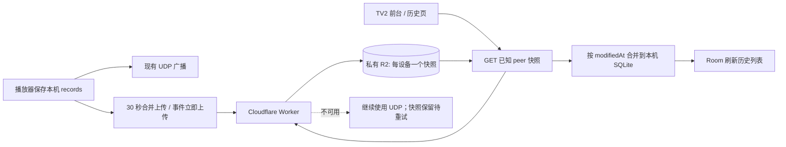

# R2 跨电视进度同步实施与验收

> **状态：已实现并通过 Sony Bravia 4K UR3（Android 10）、Hisense Fire TV AFTHU71990（Android 11）及 Xiaomi MiTV-AZFU0 / darkknight（Android 14）实机验收，2026-11-05。** 下文保留设计契约和实现说明，供后续维护。

> **验收结果：**Sony 播放并上传《兰香如故》第 47 集、4% 后休眠并停止 app 进程。Sony 报告 `Asleep` 且屏幕关闭时，重启 Hisense app；Worker 实时日志记录成功的 peer snapshot GET，Hisense 观看记录仍显示该剧第 47 集、4%（记录时间 2026-11-05 22:22:34）。随后在 Xiaomi MiTV-AZFU0（Android 14）保留数据覆盖安装，首页、历史及播放器可用，播放《小城良方》第 15 集时进度由 46% 前进到 48%，返回系统首页后 Worker 记录成功 PUT；停止 Xiaomi app 并让设备休眠后，Hisense 重启并再次读取快照。没有清除应用数据或卸载重装。

> **部署：**Worker `https://cleantv-r2-sync.jerry-shao.workers.dev`，当前生产版本 `8c506743-98f7-4e74-b3d3-afedc0157ee6`（2026-11-07 KV 授权迁移）；绑定私有 R2 bucket `cleanyourtv` 和 Durable Object 注册协调器，不绑定 Workers KV。此前含加入码/家庭合并的版本为 `3ffff7a0-f8d9-4caa-9136-f871fe6e72a0`，进度同步基线为 `511a0c02-cbee-4430-b9d6-87b2ea549918`。

> **KV 授权迁移（2026-11-07，已部署）：**`RegistrationCoordinator` 在注册时已将每个家庭的 SHA-256 哈希写入其 SQLite `families` 表；Worker 由该 Durable Object 完成哈希比较和撤销校验，注册、同步读写、加入码兑换、合并及清理路径不访问 KV。现有家庭无需数据迁移或重新加入。版本 `8c506743-98f7-4e74-b3d3-afedc0157ee6` 已上线；Hisense 实测家庭注册 `200`、快照 GET `200`、快照 PUT `204`，DO 授权 `200`，无 Worker 异常。加入码未轮换。旧 KV namespace 保留但未绑定；账号级 KV 用量需要继续观察，告警的日计数将在其所示重置时间后重新开始。授权请求会增加对当前单一协调器 Durable Object 的访问，家庭规模扩大后按 `familyId` 分片。

**目标：**让一台电视休眠时，另一台仍能读取最近一次已上传的播放进度；Cloudflare 暂时不可用时继续使用现有 UDP 同步。

**架构：**Cloudflare Worker 绑定私有 R2 bucket，作为稳定的 HTTPS 接口；每台电视只写自己的 R2 快照对象，避免对象列表和设备间写冲突。局域网 UDP 同时负责实时同步、首次自动发现家庭身份以及云端故障时的兜底。

**技术栈：**现有 Duboku v7.5 smali 补丁、Android 原生网络与 SQLite、Cloudflare Workers、SQLite-backed Durable Object、R2 Workers binding、Wrangler。

> **2026-11-06 同步顺序修复：**启动、前台恢复和首次进入历史页会请求云端读取。启动时等待最多 2 秒以便局域网家庭发现；发现家庭或设备列表变化时会补读。读取未完成或失败期间延后待发上传；读取成功并合并后丢弃待发的旧快照，从已提交数据库重新生成，再上传。已发出的 PUT 不可撤回。云端读取失败按 1、2、5、15 分钟退避；播放、本地记录和 UDP 不受阻塞。`R2Sync` 日志只记录触发原因、数量、结果和错误类别，不记录家庭身份、密钥、影片或进度。
>
> 新设备仍需在同一广播域内与已有家庭设备在线配对；`peers=0` 表示尚无可查询的已知设备，并不证明已读到其他电视。2026-11-06 的检查中，小米配对后识别到两台设备；Sony 上传用户主动回看的第 28 集后休眠并停止应用，小米冷启动从云端读取两份快照，日志显示成功合并，历史页显示第 28 集 2%，原有较新的其他影片记录保留。进入历史页及恢复前台均观察到读取完成后才上传。Sony 与小米分别使用独立临时 SQLite 数据库通过了新记录、旧记录保护、回看和事务回滚测试；测试数据库已删除。
>
> 小米短时关闭 Wi‑Fi 后恢复前台，读取因 DNS 不可用而失败；网络恢复后，首次 60 秒退避重试读取两份快照成功，随后上传。此测试没有验证断网播放或保持局域网连接时的 UDP 回退。

暂停播放器的周期保存不应把未变化的旧位置重新标记为最新。实际保存成功后才广播并排队上传；同一影片的远端进度被接受后，暂停中的旧播放器不得再写入，直到用户主动恢复播放或实际播放推进。播放保存的 SQLite 语句还拒绝覆盖时间戳更新的现有记录，防止远端合并期间已排队的旧保存倒灌。保护状态保存在应用私有偏好中；这不改变根据时间戳处理用户主动回看旧集的规则。

2026-11-07 Sony + Hisense 交叉暂停实测：Sony 播放《兰香如故》第 28 集并暂停，保持播放器打开；Hisense 播放第 47 集到约 64 秒并暂停。Sony 收到 Hisense 广播后记录 `Synced newer remote progress`，解析结果为第 47 集；随后至少三个周期保存间隔内没有再广播旧的第 28 集。Hisense 仍保持第 47 集约 69 秒，云上传成功。两台均使用已签名补丁覆盖安装，应用数据未清除。此前 Sony 第 28 集同步到小米历史页的验证、Android 隔离数据库冲突/回看/事务回滚、播放保护持久化及 SQLite 写入顺序测试也通过。

隔离数据库测试入口是 `tests/android/com/supertws/dubokutv/CloudSnapshotMergerTest.java`，连同同目录的测试替身和 `CloudSnapshotMerger.java`、`ProgressSnapshot.java`、`FamilyIdentity.java` 编译为 DEX 后，通过 `app_process` 在目标设备运行。它只使用 `/data/local/tmp/cleantv-cloud-merge-test.db`，不会访问应用数据库。`CloudSyncGateTest.java` 可在普通 JVM 使用 `-ea` 运行，覆盖读取失败及读取期间新增请求的上传门控。

---

## 1. 已锁定的设计决策

- 保持 `cleanyourtv` bucket 私有并使用 Standard 存储；APK 不访问 S3 endpoint，不内置 R2 Access Key、Secret 或预签名 URL。
- 新增 Worker 作为唯一云端入口。R2 凭据由 Worker binding 管理；家庭授权由 SQLite-backed Durable Object 校验。Worker 不绑定、不调用 Workers KV。
- 每台 TV 拥有稳定随机 `deviceId`；每个家庭拥有随机 `familyId` 和独立随机 `familySecret`。不从公网 IP、设备型号或 Android ID 推导身份。
- 首台 TV 生成家庭身份；未配对 TV 通过 UDP 自动发现并加入。家庭内所有运行本应用、处于同一广播域的设备都被视为可信成员；UDP 不作为公网安全边界。
- R2 key 固定为 `v1/<familyId>/<deviceId>.json`。每个对象保存该设备最近 20 条记录；绝不使用 `ListObjects`。
- 播放位置仍按现有路径写入本机数据库并继续广播 UDP。云端每 30 秒最多上传一次；切集、暂停、退出时立即尝试上传。上传失败只保留最新完整快照，不积累每个进度点的队列。
- 打开应用、恢复前台或首次进入历史页时，从已知的其他设备各读取一次快照。没有定时轮询；网络恢复期间按 1、2、5、15 分钟封顶退避重试。
- UDP 一直启用。Cloudflare 请求失败不得阻塞播放器、历史列表或本地保存；云端恢复后先读取并合并，再上传合并快照。
- 记录冲突沿用现有时间戳优先规则；同时间戳依次以集数和进度决胜。更新本地记录时保留已有非空 `posterUrl`、`detailPageUrl`、`videoPageUrl`。

## 2. 数据流



云端保存的是最后一次成功 PUT 的快照。电视休眠期间无法产生新进度；30 秒间隔意味着正常联网时云端最多落后约 30 秒。突然断电或断网可能丢失尚未成功上传的尾部进度。

## 3. 家庭身份和 UDP 自动发现

### 3.1 本地身份

- `deviceId`：首次启动时用安全随机数生成 UUID，写入 app-private `SharedPreferences`；升级 APK 不得重置。
- `familyId`：首次启动时客户端生成随机 UUID；保存在同一偏好文件。首次注册会把该 ID 固定为 Worker family key。
- `familySecret`：首次启动时客户端生成 32 字节随机值，base64url 编码；仅家庭成员间授权 Worker 请求。保存在 app-private 偏好文件，禁止写日志或普通诊断信标。
- UDP peer roster：保存已发现的 `deviceId`，仅用于指定 R2 GET key；不保存公网 IP 作为身份。

### 3.2 UDP 消息

沿用现有 UDP 端口 9876 和既有 JSON 传输，不新增 Android 权限。新动作均带 `from=deviceId` 和随机 `nonce`，接收端过滤自身消息。

```json
{"action":"FAMILY_DISCOVER","from":"<deviceId>","nonce":"<random>"}
```

已有家庭的设备对请求源 IP 单播回复：

```json
{
  "action":"FAMILY_OFFER",
  "from":"<deviceId>",
  "familyId":"<uuid>",
  "familySecret":"<base64url>",
  "devices":["<deviceId>","..."]
}
```

- 每次应用启动/前台恢复均广播发现，收集 2 秒；身份已保存的 TV 也回复当前身份。
- canonical family 使用所有已收到 offer 中字典序最小的 `familyId`，因此无需设备时钟比较。若本机 ID 不是 canonical，必须采用携带 canonical ID 的 offer 中的 `familySecret` 和 roster，并广播 canonical offer；禁止出现“身份已保存就永不更改”的分支。
- 尚无身份的 TV 若收到一个或多个 offer，按同一规则选定 canonical ID。若 2 秒内无响应，则本机生成 ID/secret、调用幂等注册接口，再广播 offer。
- 迁移家庭身份时保留本机 records；先拉取 canonical family 的已知设备快照并合并，再上传本机快照。旧家庭对象可作为孤儿对象留存，不执行 bucket 列表或全桶删除。
- 同一广播域中的多个 Duboku 家庭会自动合并到最小 familyId；v1 明确假设一个广播域就是一个家庭同步组，不提供多组选择 UI。
- Worker 只接受格式正确的 UUID、设备 ID 和秘密；UDP 发现只在本地广播网段处理。`familySecret` 经 UDP 明文传输，故该实现假设家庭 LAN 可信；此秘密不是 Cloudflare/R2 API key。
- 新电视首次自动加入需要同一广播域内至少有一台已配对电视在线。之后电视可休眠，其他设备仍通过 R2 同步。

## 4. Worker API 契约

Base URL 用部署后 Worker 的 HTTPS URL，通过 APK 的一个常量配置。请求体和响应统一 JSON/UTF-8。除家庭创建接口外，所有接口要求 `Authorization: Bearer <familySecret>`。Worker 计算 `SHA-256(familySecret)` 并交由 Durable Object 与注册时保存的哈希作常量时间比较，同时检查家庭撤销标记。禁止记录 Authorization、familySecret、请求正文或预签名参数。

### `POST /v1/families`

首次设备建家庭。客户端先生成并持久化随机 `familyId` 和 32-byte `familySecret`，再发送注册请求。这样即使响应丢失，客户端仍可用同一请求重试恢复授权。

Request:

```json
{"familyId":"<uuid>","familySecret":"<base64url-32-byte-random>"}
```

首次注册返回 `201 Created`；相同 ID/相同秘密重试返回 `200 OK`。同一 ID 对应不同秘密返回 `409 Conflict`。Worker 仅把秘密哈希写入 Durable Object SQLite；不访问 R2 或 KV。按来源 IP 对创建请求限速（每小时最多 10 次），限速计数保存在 Durable Object SQLite。

```json
{"familyId":"<uuid>","registered":true}
```

秘密不会由 Worker 返回；客户端在注册前已持久化，并仅通过局域网 `FAMILY_OFFER` 交给新设备。

### `GET /v1/sync/{familyId}/{deviceId}`

读取一个已知 peer 快照。成功时 `200 OK`，返回：

```json
{
  "schemaVersion":1,
  "familyId":"<uuid>",
  "deviceId":"<uuid>",
  "updatedAt":<epochMillis>,
  "records":[
    {
      "id":"...","name":"...","episode":"第5集",
      "progressInMillis":120000,"durationInMillis":2400000,
      "createdAt":<epochMillis>,"modifiedAt":<epochMillis>,
      "videoPageUrl":"...","detailPageUrl":"...","posterUrl":"..."
    }
  ]
}
```

对象不存在时仍返回相同结构的空 `records`，不把首次读取当错误。每个 GET 恰好调用一次 R2 `get`（Class B）。

### `PUT /v1/sync/{familyId}/{deviceId}`

用本机完整快照覆盖本机对象。请求体格式与 GET 返回结构相同。要求 `familyId/deviceId` 与路径完全相同、`schemaVersion=1`、记录数不超过 20、总正文不超过 64 KiB、进度和时长非负、URL 字段长度受限。Worker 授权时由 Durable Object 同时校验秘密哈希和撤销标记，通过后一次 R2 `put`（Class A），返回 `204 No Content`。每台设备只写自己的 key。家庭清理会写入不可逆 familyId tombstone；旧电视即使保留旧 secret 也不能重新注册或重建快照。

客户端对每个 device key 使用 single-flight 串行上传：任一时刻最多一个 PUT；超时后先重试完全相同的幂等快照，成功后才发送期间合并出的最新快照。Worker 不为 PUT 额外 GET R2，因此不会产生额外 Class B；revision 不作为并发控制字段。

### 错误和客户端处理

| HTTP | 含义 | 客户端行为 |
|---|---|---|
| 400 | JSON、ID、schema 或字段无效 | 丢弃该快照并记录脱敏错误 |
| 401 | 家庭秘密无效/家庭未注册/已撤销 | 保留本地/UDP 同步且不自动换家庭；授权查询由 Durable Object SQLite 提供强一致校验 |
| 404 | 未知路由 | 不重试 |
| 413 | 快照超限 | 仅上传最近 20 条；记录错误 |
| 429 / 5xx / 网络超时 | 暂时失败 | 指数退避；合并为最新一份快照 |

Worker 对未知 method/path 返回 404；CORS 不作为 Android 原生客户端的认证机制。公开访问 R2 bucket 保持关闭。

## 5. R2 操作预算

- 一个设备快照 PUT = 1 次 Class A；一个 peer 快照 GET = 1 次 Class B。
- 不执行 `LIST`、`HEAD`、单集单对象写入、周期性空轮询或为每条记录拆分对象。
- 按每天播放 2 小时、每 30 秒上传一次估算：每设备约 `2 × 3600 ÷ 30 × 30 = 7,200` 次 PUT/月；暂停/切集立即上传会略增。
- 两台 TV 中，TV2 每天打开 10 次且每次只读 TV1 一次，约 300 次 GET/月。设备数为 N 时，一次全量同步最多 `N-1` 次 GET。
- R2 免费额度以当前账户定价页面为准；R2 对象操作与 Worker、Durable Object 调用分开计量。此 Worker 不产生 Workers KV 操作。

## 6. Android 接入和降级

### 6.1 上传

- 使用现有 `records` SQLite 表作为快照来源，不增加数据库迁移。
- 监听已提交的播放记录变更；上传必须在本地 Room 保存成功之后读取数据库，不能复用当前在本地保存前触发的 `broadcastProgress` 调用作为 cloud payload。
- 新增单线程 cloud sync queue；同一时刻只处理一个请求。30 秒窗口内多个变更合并为一次最新快照；切集、暂停、播放器退出时立即排队一次。
- 失败不覆盖本地数据、不阻塞播放；保留 `cloudDirty=true`，重试时从数据库重新构造完整快照，成功后清除 dirty。不要把每个 5 秒进度点存成独立上传任务。

### 6.2 下载与合并

- 前台恢复/历史页首次挂载时，先运行现有 UDP `REQUEST_SYNC`，并通过 Worker GET 已知 peer 的对象。
- 收到云端快照后使用现有冲突/重复剧处理逻辑合并 SQLite；只在内容确实变化时刷新 Room/Compose。
- 云 GET 结束且合并完成后，再上传本机合并快照（仅本机有更新或 roster 变更时）。不得在 GET 前把旧本机全量数据 PUT 到云端。
- UDP 记录和云端记录走同一个本地 merge helper。UDP 仍在云端成功时运行，以提供局域网低延迟；云端失败时它是可用的独立备份通道。
- 每次启动/前台恢复都允许一次云拉取；同一页面重组不再次拉取。网络失败退避 1/2/5/15 分钟，隐藏或进程退出时停止重试。

### 6.3 故障边界

- R2/Worker 不可达：本地保存和 UDP 同步照常；云端标记 dirty，按退避重试。
- TV1 睡眠：云端只提供它最后成功上传的快照；不能承诺恢复不到该上传窗口内的秒级尾差。
- Worker/Durable Object 授权失败：不清除家庭身份、不将记录上传到新家庭；UDP 仍运行。需要通过应用升级或管理方式修复授权。
- UDP 无 peer：云端读写仍可工作；首次新 TV 配对则需要已有 TV 醒着、在同一广播网段。

## 7. 实施文件和工作项

### 工作项 A：Cloudflare Worker

**新增目录：**`apks/patches/duboku-v7.5/r2-sync-worker/`

- 新增 `wrangler.toml`，配置 `R2_BUCKET` binding 指向 `cleanyourtv`；R2 保持 private。环境变量不得包含 S3 access key。
- 新增 `src/index.ts` 实现三条路由、JSON schema 校验、Durable Object 家庭授权、R2 key 构造、大小限制和脱敏错误。对象 key 必须由校验后的 path IDs 构造，不能接受任意 key。
- 新增单元/本地 Worker 测试覆盖新建家庭、GET 空对象、PUT/GET round-trip、跨家庭 401、路径错配、payload 超限和未知路径。
- 部署时用 Wrangler 登录当前 Cloudflare 账户，绑定现有 bucket 并部署 Worker；无需创建或绑定 KV namespace。把 Worker URL 写入 Android 构建常量。部署凭据不进入 Git。

### 工作项 B：Android UDP 身份和云同步

**主要 Java 参考源：**`LanSyncManager.java`、`CloudSyncClient.java`、`FamilyIdentity.java`、`ProgressSnapshot.java`。**APK 实际类：**`smali_classes3/com/supertws/dubokutv/LanSyncManager.smali`、`FamilyIdentity.smali`、`ProgressSnapshot.smali` 及 `LanSyncManager$*.smali`；`CloudSyncClient` 与新增家庭同步页在 `smali_classes4`。

- Java 参考源与对应 smali 按现有仓库约定手动保持同步；只有 smali 被 apktool 打入 APK，不能只复制 Java 文件。家庭设置从个人菜单进入，排列在“设置”下方并在右侧面板显示；家庭同步不再注册独立启动器入口，同步身份/播放器回调仍放在现有同步类中。
- 家庭设置的云端同步与局域网络同步是独立开关，均默认开启，状态保存在本机安装的 app-private SharedPreferences；加入家庭及同步协议不传输这两个开关，因此相同 familyId 的电视仍可各自设置。关闭 LAN 后不监听、处理或发送 UDP 同步包，本机播放与记录不受影响；重新开启会恢复监听并请求在线设备回传记录。关闭云端同步时云端管理控件置灰，但两个同步开关保持可操作。
- `CloudSyncClient` 仅用 Android 已有 HTTP/TLS API，避免新增第三方依赖；`FamilyIdentity` 负责随机身份、偏好持久化和 UDP offer；`ProgressSnapshot` 只负责 records DTO 与 schema 验证。
- 实现随机 `deviceId`、家庭身份持久化和 UDP `FAMILY_DISCOVER/FAMILY_OFFER`。保持现有 `REQUEST_SYNC`、progress packet、接收入库和 Room 刷新行为。
- 实现 Worker HTTP 调用、单线程上传队列、30 秒合并窗口、事件立即上传、peer GET、重试状态与成功时间。
- 把 UDP 和云快照都交给同一 merge helper；旧本地记录不因配对或云端首次加载而清空。
- 在构建 patch 时覆盖 smali 树和 `AndroidManifest.xml`，不要只复制 Java 参考文件；沿用 `duboku-v7.5-patch-notes.md` 中 apktool 构建流程。

## 8. 验收测试

### Worker 自动化

- Worker 测试：`node --experimental-strip-types --test test/worker.test.mjs` 覆盖加入码兑换/限流、快照复制读回校验、无快照拒绝清理及清理后 familyId tombstone；本次 KV 架构调整后通过：13 项通过、0 项失败。
- `POST /v1/families` 新建返回 201；相同请求重试返回 200；同 ID 换秘密返回 409；超过 IP 限额返回 429；Durable Object 保存哈希而非明文，不产生 KV 操作。
- 有效家庭秘密能创建本机快照并读取；错误秘密、其他 familyId 和篡改 path 均拒绝。
- 不存在的对象返回空快照；错误 JSON、负数进度、21 条记录和大于 64 KiB 请求均拒绝。
- Worker 测试断言一条 GET 只调用一次 R2 `get`、一条 PUT 只调用一次 R2 `put`，所有路由均未调用 list。

### Android / 多机实测

- [x] TV1 播放并上传后进入睡眠；停止 Sony app 进程并确认电视为 `Asleep` / 屏幕关闭。重启 TV2 app 后，Worker 实时日志出现成功的 R2 peer GET，Hisense 历史显示《兰香如故》第 47 集、4%，没有依赖 TV1 唤醒或播放。
- 云端关闭/超时：TV1 与 TV2 仍通过现有 UDP 同步；恢复云端后 dirty 快照上传并合并，不出现请求风暴。
- 首次安装两台 TV 同 LAN 时自动交换家庭身份；后续进程重启保留 identity/device roster；新设备需要至少一个已配对 peer 在线。
- 同剧不同集、同集远端更新、意图回看旧集、重复 UDP 包、旧云快照、封面/URL 为空等冲突场景不倒退或清空有效链接。
- [x] 检查 history UI 刷新和播放器接续功能；Sony 与 Hisense 均启动应用并显示首页，Sony 实际播放，Hisense 刷新观看记录。
- [x] Xiaomi MiTV-AZFU0 / darkknight（Android 14）：`adb install -r` 覆盖安装，保留本地数据；首页/观看记录正常；《小城良方》第 15 集播放后由 46% 更新到 48%；系统返回后 Worker 收到成功 PUT。停止 Xiaomi app 并休眠后，Hisense 刷新时 Worker 记录成功 GET。ADB 抓屏在播放时显示黑色视频层；ExoPlayer 已初始化且进度前进，但实际视频画面未能通过抓屏独立确认。
- 未做：Android 5.1 设备验证、故障注入/冲突全矩阵、R2 Metrics 操作计数核对。Worker 自动化测试断言 GET 单次 `get`、PUT 单次 `put` 且不执行 list。

### 构建与发布检查

1. Worker：运行单元测试后部署到 production。该次设备验收确实向正式家庭快照写入/读取进度，不创建测试对象。
2. APK：在原始反编译目录覆盖 patch 文件后运行 `apktool b duboku_src -o unsigned.apk`；确认所有 DEX 成功生成，再按现有发布流程签名并双机安装。
3. 确认 APK 中不含 R2 S3 keys、API token、familySecret 常量或 1 小时测试预签名 URL；确认浏览器创建的临时 `cleanyourtv-presign-temp` token 不作为运行凭证。

## 9. 迁移和运维

- 不改 Room schema；已有本地 records 保留。升级后首次启动通过 UDP/Worker 建立身份，再合并已知云快照。
- 不从旧 UDP 广播内容导入家庭身份；仅有效的 `FAMILY_OFFER` 建立家庭绑定。
- familySecret 丢失且无在线 peer 时无法恢复对已有家庭云对象的授权；v1 不做账号找回。设备仍可使用本地记录和 UDP，需同 LAN peer 在线重新获取身份。
- 不配置自动删除旧对象或全桶生命周期规则；每个家庭和设备只占一个小快照。孤儿对象由后续管理工具按显式前缀清理，不在正常同步中执行删除或列表。
- 监控 Worker、Durable Object 使用量、R2 Class A/B 和 Storage；确认 Worker 的 KV 绑定与 KV 调用为零；不得记录家庭秘密或剧目播放 URL。

## 10. 假设和已知风险

- 同一家庭内所有 Duboku TV 位于同一 UDP 广播域；同一广播域内多个独立家庭会按字典序最小 familyId 合并为一个家庭。v1 不提供手动选择或 QR 配对。
- 通过 UDP 传递 familySecret 意味着同一 LAN 上可监听流量的设备可能加入家庭；这是无用户交互配对的安全取舍。绝不通过 UDP 传递 Cloudflare API token/R2 key。

## 11. 电视加入码与多家庭合并

**部署与实机验证（2026-11-07）：**Worker 已设置随机 32-byte `JOIN_CODE_KEY` 并部署为 `3ffff7a0-f8d9-4caa-9136-f871fe6e72a0`。Sony Bravia 4K UR3、Hisense Fire TV 和 Xiaomi MiTV-AZFU0 均以匹配现有证书的覆盖安装保留应用数据；三台设备“家庭同步”页均显示目标 familyId `214cbca3-5707-46cf-b305-1c4aa924773d`，Hisense 与小米的云端读取和本机上传日志均成功。执行时在 Hisense 误点了轮换加入码，故最初提供的加入码已失效；Hisense 随后成功兑换了新生成的同家庭加入码。小米在兑换前已持有目标 familyId 和可用云端凭据，无需重加。未执行 family merge 或清理。原 Hisense 截图保存在执行环境 `/private/tmp/hisense-family-joined.png`。

**家庭入口可发现性：**在个人菜单中新增“家庭”条目，位置紧跟“设置”；选中后家庭设置显示在右侧内容区。加入码、加入家庭和家庭合并操作复用家庭身份与云同步 API。构建涉及 `ProfileScreens` 枚举、菜单目的地、Compose AndroidView 容器及 `FamilySyncPanel` Java 参考源码和 `smali_classes5` 实际类（打入 APK 的 `classes5.dex`）。当前电视桌面仅保留 `SplashActivity` 主入口，旧 `FamilySyncActivity` 保留为非导出 Activity，不注册桌面快捷入口。Hisense 遥控器回归发现个人菜单到家庭右侧面板的焦点交接仍有问题，不能以静态显示或子页内按钮焦点测试代替完整导航验证。

**云同步关闭状态：**关闭开关会取消排队的云读取/上传并使旧代次任务失效；已发出的单个 HTTP 请求无法撤销。关闭期间不读写云端，加入码/兑换/家庭合并接口也拒绝请求；面板中的加入码、加入和合并控件及输入框置灰，仅保留开关和只读家庭信息。重新开启会先请求云端读取，再按数据库当前快照上传；局域网同步与本地播放不受影响。

**Android 5.1/API 22 网络列表失败修复（2026-11-07）：**小米 3 诊断日志显示主列表网络请求线程 `z Dispatcher` 抛出 `NoClassDefFoundError`，调用栈到 `mc.c.h`。根因是 OkHttp cleartext 策略检查在 API 22 调用了 API 23 才存在的 `android.security.NetworkSecurityPolicy`。已在 `mc.c.h` 增加 API<23 快速返回 `true`，让 Android 5 使用其默认明文策略；API 23+ 保留原策略检查。之前调整的 `About`/`Support` enum ordinal（4/5）仍保留，但不是这次网络请求失败的根因。已重建无诊断上报代码的干净 APK；三份包 SHA-256 均为 `51c83a7960b3723a9baa15c938770646e7c4681186a89e96ca9acbc7f5bfd677`。真实小米 3 安装回归仍待完成。

**通用 APK 构建基线：**统一使用 `apks/common/Updated独播库TV_v7.5.apk`（`minSdk=22`，含 Xiaomi 3 Android 5.1.1 的 native/API 兼容补丁）作为解码基包，再叠加本目录补丁；不要用 Sony 或其他设备当前安装包作为基包。Coil 图片请求在 API<26 时将任意 HTTPS 图片 URL 改为 HTTP，覆盖云端快照可能带来的非 `pic.dbokutv.com` 图片域名。

**封面回退与通用包复核（2026-11-07）：**旧 `fixImageUrl` 只把 `https://pic.dbokutv.com` 改成 HTTP；Android 5.1.1 上其他 HTTPS 海报域名仍会走失败路径并显示占位 D。现已对 API<26 的 Coil 图片 URL 统一降级为 HTTP（现代设备仍使用 HTTPS）。后续 API 22 cleartext 策略修复已并入通用包；三份 APK 的最新 SHA-256 见上条。Sony 和 Hisense 已覆盖安装，最新构建尚未在小米盒子 3 上实机回归。

**封面 D 再现修复与兼容构建防遗漏（2026-11-08）：**复核发现 `cleanyourtv/patches` 已按任意 HTTPS 降级，但发行目录 `apks/patches` 仍是旧的 host-only 代码；构建时用旧镜像覆盖 API 22 基底里的新逻辑，导致其他海报域名在 Xiaomi 3 上回退到 D 占位。现已同步 Java/Smali，并将 API<26 URL 改写为匹配通用 `https://` scheme；API 26+ 不改 URL。新增 `tests/test_legacy_image_urls.py` 锁定 Java 与 Smali 行为。之后分发 APK 必须用 `apks/patches/duboku-v7.5/build_universal_apks.sh` 构建：除固定 API 22 兼容基底、native shim、API 22 补丁、签名和库校验外，还会拒绝发行目录与 `cleanyourtv/patches` 的关键图片补丁源发生漂移，并同步更新三份 APK。当前三份包 SHA-256：`9037b4804ed4e41873d1159118184f72046ddb6e255d7b4d2869887933eb8ff1`。Sony、Hisense、Xiaomi Mi Box 5 Max 覆盖安装启动成功；Xiaomi 3 ADB 暂不可用，封面实机结果待设备重新连接确认。

### 11.1 单个已有家庭：显示并记下加入码

1. 在已加入家庭的电视个人菜单选择 **家庭**（位于设置下方）。
2. 选择 **生成 / 更换加入码（旧码立即失效）**，再在确认框选择 **确认更换**。Worker 用该电视现有 familySecret 认证，生成 80-bit 随机码；屏幕显示 `XXXX-XXXX-XXXX-XXXX` 格式，可手抄到新电视。按返回或选择取消不会更换加入码。
3. 加入码可以复用，直到再次生成新码或显式清理源家庭；重新生成会立刻让旧码失效。每家庭每小时最多生成 10 次。
4. 新电视在相同入口输入加入码。Worker 验证后返回 familyId、familySecret 和家庭已有快照设备 ID；新电视保留自身本地 records，改为该家庭身份，然后先读取家庭 peer 快照再合并/上传。

Worker 不保存可直接读取的明文 familySecret：加入码只以哈希索引，凭据以 AES-GCM 加密保存；解密密钥 `JOIN_CODE_KEY` 必须作为 Worker Secret 配置，不能写入仓库、APK 或日志。兑换按 IP 每小时最多 30 次。加入码是可手抄的 bearer credential，获得它的人可以加入该家庭；需要撤销时在原电视重新生成新码。已经部署的旧 Worker 没有这些 API，必须先部署兼容版本才可用。

### 11.2 重复创建 familyId：复制、核验、再清理

1. 先在将保留的 **最小字典序 familyId** 电视打开家庭同步页。向每个待合并家庭的设备生成并手抄加入码，再逐行输入到保留电视。
2. 选择 **预览旧家庭记录**。Worker 只列出这些明确输入的源 `v1/<familyId>/` 前缀，报告源家庭、快照、记录和设备数量；普通上传/下载仍不执行 LIST。
3. 选择 **复制记录到当前家庭**。Worker 逐设备合并源与目标快照，保留每剧时间较新记录（同时间比较集数、进度），只写目标前缀并逐个读回验证；TV roster 随后加入这些 peer 设备供正常云读取。
4. 检查新家庭进度，只有确认复制结果可用后才选择 **确认清理旧 familyId 和快照**，并在二次确认框确认。Worker 会重新读取源快照指纹；复制后有变更则拒绝删除并要求重新复制。成功后只删除明确列出的源家庭对象、撤销源 family auth 与加入码，保留目标对象。
5. 清理中途失败可用同一加入码重试；目标快照已经复制，不会因此删除。若源家庭从未有云端快照，Worker 拒绝清理，先让旧家庭设备联网并上传本地记录。旧电视仍保存旧身份时，必须输入保留家庭的加入码重新加入；旧凭据被撤销后不再能云同步。

目标必须是所有参与家庭中 ID 最小者，和现有 UDP 自动选择规则一致。若当前电视不是最小 ID，先让保留 ID 的电视加入其他家庭，再由它执行合并。单次最多 8 个源家庭、每个源最多 500 个快照；超过上限时分批合并到同一个最小 ID 目标。并发设备可能在“读指纹”和 R2 删除之间继续写源快照；若设备仍活跃，先停止其播放/同步，再执行最终清理，清理后将它重新加入目标家庭。

### 11.3 代码入口

- `FamilySyncPanel.java`、`smali_classes5/com/supertws/dubokutv/FamilySyncPanel*.smali` 与 `smali_classes3/com/supertws/dubokutv/presentation/screens/profile/FamilySyncRoute.smali`：个人菜单右侧嵌入的家庭设置面板。
- `FamilySyncActivity.java` 与 `smali_classes4/com/supertws/dubokutv/FamilySyncActivity*.smali`：保留的非导出旧 Activity；日常家庭设置入口为个人菜单内嵌面板。
- `FamilyIdentity.java` / `FamilyIdentity.smali`：加入后保存云端返回的家庭凭据及已知设备 roster，保留本机 deviceId 和记录。
- `CloudSyncClient.java` / `smali_classes4/com/supertws/dubokutv/CloudSyncClient*.smali`：签发、兑换加入码与 preview/copy/cleanup HTTP 调用。新类放到 classes4 以避免继续增加接近 DEX method-reference 上限的 classes3。
- DEX 唯一性：API-22 基础 APK 仍带有旧 `CloudSyncClient` classes3 副本；发布构建必须在合并 overlay 后删除 classes3 中所有 `CloudSyncClient*.smali`，只保留 classes4 完整实现。否则 Android 可能加载旧类，家庭面板调用新方法时抛出 `NoSuchMethodError` 并退出应用。`tests/test_cloud_sync_dex_uniqueness.py` 与构建后 DEX 检查覆盖此约束。
- 家庭菜单图标：`ProfileScreens.Family` 使用新增 `ic_profile_family` 群组图标资源，构建时同时覆盖 `ProfileScreens.smali` 和资源定义；个人入口仍保留单人图标。
- 家庭面板导航：家庭首页保留云端/局域网开关与三个操作入口；加入码、新电视加入、旧家庭合并分别进入独立面板页。轮换加入码和永久清理确认改为面板内步骤；旧家庭操作仍需先预览、再复制，且加入码不匹配时清理按钮保持不可用。家庭 `AndroidView` 的 Compose modifier 加入焦点搜索；原生根 `ScrollView` 可聚焦并使用 `FOCUS_AFTER_DESCENDANTS`，且在视图挂载后请求首个开关焦点，避免路由切换时 Compose 将焦点退回外层主菜单。面板子页使用遥控器返回键返回父页，不再显示重复的“返回家庭同步”按钮。该路由 smali 与 Java 面板均纳入构建镜像校验。Hisense 焦点验证需覆盖从“家庭”行进入首个原生控件，再在子页按返回回到家庭首页。`FamilySyncPanel.java` 与 `smali_classes5/FamilySyncPanel*.smali` 必须同步，特别是 `FamilySyncPanel$1/$2` 两个输入监听类；家庭面板导航测试检查它们随 APK 一起打包，防止新电视加入或合并页点击后因 `NoClassDefFoundError` 退出。
- `r2-sync-worker/src/index.ts`：单码轮换/兑换及显式家庭快照迁移、复制读回、源身份撤销。
- 上传间隔 30 秒是费用与断点新鲜度折中；突发休眠的尾差不超过约一个上传窗口，但网络失败时可能更久。
- 网络超时后原 Worker PUT 理论上可能晚于相同请求重试和较新快照完成，短暂覆盖较新对象；single-flight 会降低概率，下一次成功快照会修复。v1 接受此低概率窗口，不为每个 PUT 额外读取 R2 或引入 Durable Object 排序。
- Worker 源码配置及生产 Worker 均已移除 KV binding；该 Worker 不再产生 KV 操作。当前注册协调器为单一 Durable Object；三台电视的家庭规模较小，若请求量明显增加，应按 familyId 分片。R2 Metrics 的 Class A/B 实际用量仍需在 Cloudflare 控制台核对。

## 参考

- [Cloudflare R2 定价和操作分类](https://developers.cloudflare.com/r2/pricing/)
- [通过 Workers 使用 R2](https://developers.cloudflare.com/r2/api/workers/workers-api-usage/)
- [R2 Workers API 参考](https://developers.cloudflare.com/r2/api/workers/workers-api-reference/)
- [Workers 定价](https://developers.cloudflare.com/workers/platform/pricing/)
